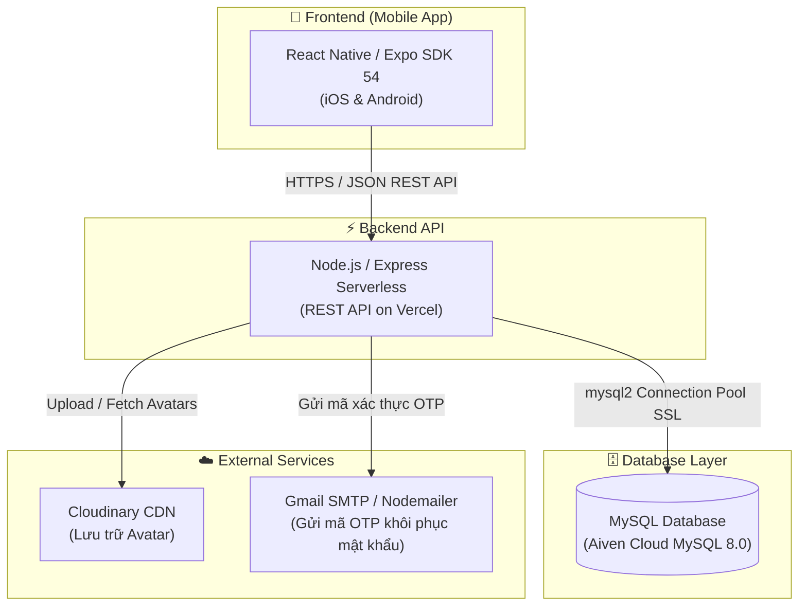
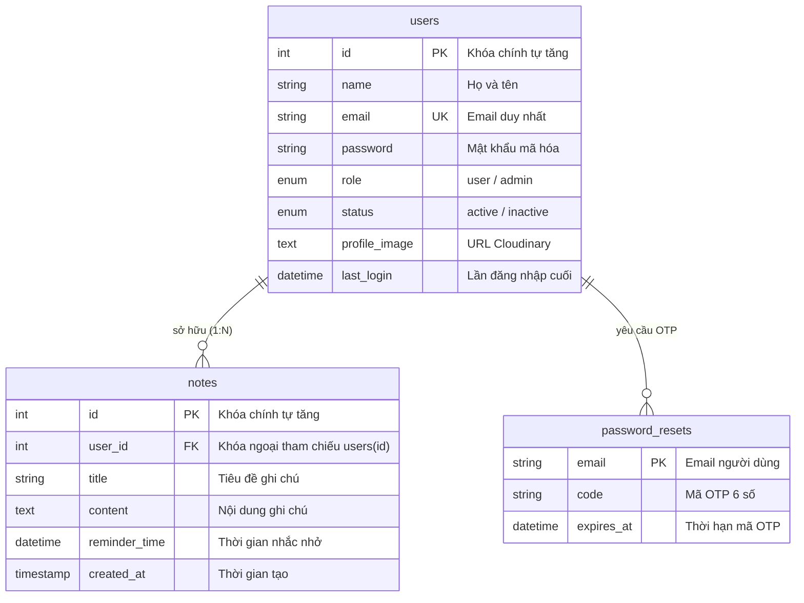

# Notes App 📝 - Hệ thống Quản lý Ghi chú Đa nền tảng

Ứng dụng quản lý ghi chú hiện đại được xây dựng với kiến trúc **Fullstack**: Frontend Mobile kết nối Backend RESTful API và Cơ sở dữ liệu **MySQL**.

---

## 🏗️ Kiến trúc hệ thống (System Architecture)



---

## 🛠️ Công nghệ sử dụng (Tech Stack)

- **Frontend:**
  - [React Native](https://reactnative.dev/) & [Expo](https://expo.dev/) (SDK 54)
  - React Navigation, Vector Icons, Print (PDF Export), Notifications
- **Backend:**
  - [Node.js](https://nodejs.org/) & [Express.js](https://expressjs.com/)
  - Thư viện kết nối CSDL: `mysql2` (Connection Pool Serverless)
  - Mã hóa bảo mật: MD5 / Crypto
  - Dịch vụ email: `nodemailer` (Gmail SMTP)
- **Cơ sở dữ liệu (Database):**
  - **MySQL 8.0** lưu trữ trên [Aiven Cloud Database](https://aiven.io/)
  - File lược đồ CSDL: [`schema.sql`](./schema.sql)
- **Lưu trữ đám mây & Triển khai:**
  - [Vercel](https://vercel.com/) (Serverless Deployment)
  - [Cloudinary](https://cloudinary.com/) (Quản lý hình ảnh đại diện)

---

## 🗄️ Lược đồ Cơ sở dữ liệu MySQL (Database Schema)

Dự án sử dụng cơ sở dữ liệu quan hệ **MySQL** với các bảng chính:



Chi tiết các câu lệnh DDL và Stored Procedures nằm trong file [`schema.sql`](./schema.sql).

---

## 🚀 Hướng dẫn cài đặt & Khởi chạy

### 1. Cài đặt Dependencies
```bash
npm install
```

### 2. Khởi chạy ứng dụng Mobile (Expo)
```bash
npx expo start
```

### 3. Khởi chạy Backend cục bộ (Tùy chọn)
```bash
node backend/server.js
```
*(Backend hiện tại đã được triển khai tự động trực tuyến 24/7 trên Vercel).*
